# Enterprise-Grade Autonomous HR Onboarding Engine

An event-driven, fault-tolerant HR onboarding and ATS pipeline built using **n8n**, **Supabase (PostgreSQL)**, **OpenAI**, **DocuSign**, and **Slack**.

This project solves a common backend problem in workflow automation: **how to handle long-running asynchronous processes (like waiting 3 days for a candidate to sign an employment contract) without losing system state or relying on volatile in-memory timers.**

Instead of memory dependency, this system uses a **Database-Driven State Machine** pattern.

---

## 🏛️ System Architecture

```mermaid
flowchart LR
    classDef trigger fill:#e1f5fe,stroke:#0288d1,stroke-width:2px,color:#01579b;
    classDef process fill:#fff3e0,stroke:#f57c00,stroke-width:2px,color:#e65100;
    classDef db fill:#e8f5e9,stroke:#388e3c,stroke-width:2px,color:#1b5e20;
    classDef external fill:#f3e5f5,stroke:#7b1fa2,stroke-width:2px,color:#4a148c;
    classDef gate fill:#fbe9e7,stroke:#d84315,stroke-width:2px,color:#bf360c;

    subgraph Phase1 ["1. Intake & AI"]
        A[PDF Resume Upload]:::trigger --> B[n8n Form & Parser]:::process
        B --> C[OpenAI Schema Validation]:::process
    end

    subgraph Phase2 ["2. Persistence & E-Sign"]
        C --> D[(Supabase DB)]:::db
        D --> E[DocuSign API Dispatch]:::external
    end

    subgraph Phase3 ["3. Async & HITL"]
        E -.->|1-3 Days Delay| F[DocuSign Webhook]:::external
        F --> G[(Status: Signed)]:::db
        G --> H[Slack Block Kit Card]:::gate
    end

    subgraph Phase4 ["4. Provisioning"]
        H -.->|Manager Click| I{Switch Gate}:::gate
        I -->|Approved| J[(Status: Approved)]:::db
        J --> K[IT Workspace Setup]:::process
        K --> L[(Audit Log)]:::db
        L --> M[Slack: Update Approved]:::external

        I -->|Rejected| N[(Status: Rejected)]:::db
        N --> O[Slack: Update Rejected]:::external
    end
```





---

## ⚙️ How It Works (The Complete Flow)

### 1. Candidate Intake & AI Screening (Phase 1)

- The candidate uploads their resume PDF through a secure web form.
- n8n extracts the raw text from the binary file and sends it to OpenAI (gpt-4o-mini) with a strict JSON schema.
- The AI parses the resume, evaluates experience, and returns a structured qualification score.

### 2. Database Persistence & Contract Dispatch (Phase 2)

- The parsed candidate data and AI score are stored inside Supabase PostgreSQL.
- The system immediately triggers the DocuSign API to dispatch an employment agreement.
- The candidate's record state in the database is updated to `Pending_Signature`, and the initial workflow closes safely, consuming zero server resources while waiting.

### 3. Asynchronous Webhook & State Transition (Phase 3)

- Days later, once the candidate signs the agreement, DocuSign fires a secure webhook back to our system.
- The workflow catches the event, updates the candidate status to `Signed` in Supabase, and posts an interactive card to Slack using Block Kit.

### 4. Human-in-the-Loop (HITL) & IT Provisioning (Phase 4)

The hiring manager reviews the candidate details directly in Slack and clicks **Approve** or **Reject**.

Based on the button click, a conditional switch routes the logic:

**If Approved:**
- Status updates to `Approved`.
- A mock IT provisioning HTTP request runs.
- An audit log is written to Supabase.
- The Slack message updates in-place to show approval.

**If Rejected:**
- Status updates to `Rejected`.
- The Slack message updates accordingly.

---

## 🛠️ Tech Stack

| Component | Technology |
|---|---|
| Orchestration | n8n (Self-Hosted) |
| Database | Supabase (PostgreSQL) |
| AI Engine | OpenAI API (gpt-4o-mini) |
| E-Sign | DocuSign REST API & Connect Webhooks |
| Notifications / UI | Slack API (Block Kit) |

---

## 📂 Repository Layout

```text
hr-onboarding-automation/
│
├── workflows/
│   ├── phase1_ingestion_ai.json
│   └── phase2_docusign_slack_approval.json
│
├── docs/
│   ├── architecture-diagram.png
│   └── database-schema.sql
│
├── .env.example
├── .gitignore
└── README.md
```

---

## 🚀 Getting Started

### 1. Setup Database

Run the SQL queries provided in `docs/database-schema.sql` inside your Supabase SQL Editor to create the `candidates` and `audit_logs` tables.

### 2. Import Workflows

- Open your n8n dashboard.
- Import both JSON files located inside the `workflows/` directory.

### 3. Environment Variables

Create a local `.env` file using `.env.example` as a template and provide your API credentials for OpenAI, Supabase, DocuSign, and Slack.

---

## 👨‍💻 Author

**Naveed Ahmed**

AI & Automation Developer

- GitHub: [@Naveed786Ahmed](https://github.com/Naveed786Ahmed)
- LinkedIn: Naveed Ahmed
